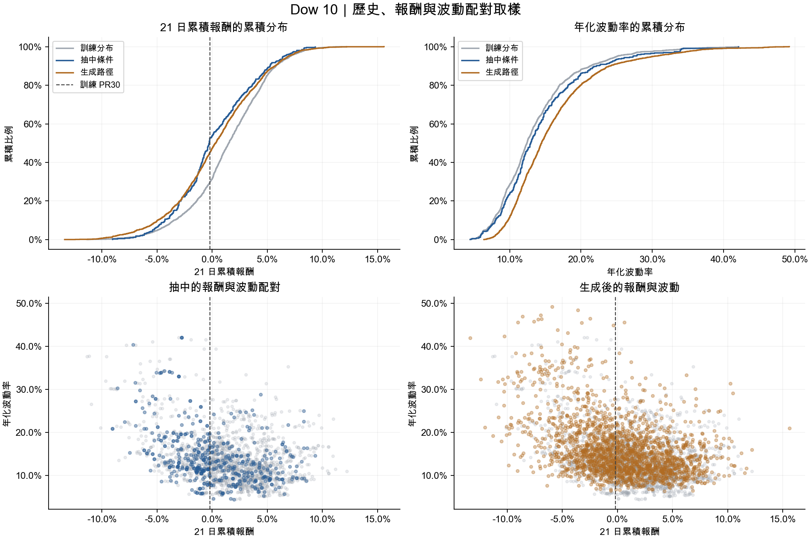
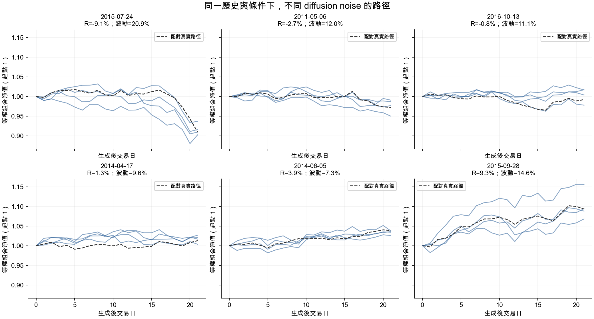

# Dow 10：70% 完整分布＋30% PR30 以下的聯合條件取樣

已完成條件式 TimeDiff 重訓、聯合取樣、2,000 條路徑生成與獨立稽核。本輪沒有執行 PPO，也沒有覆寫舊實驗結果。

**取樣與歷史配對正確；生成路徑具有差異，但條件符合度與市場結構仍有偏差。** 這批可以作為後續研究的候選資料，尚不能據此認定能改善 PPO 的風險表現。

## 本次設定

- TimeDiff 沿用既有 Dow 10 條件式架構：10 檔股票、30 個特徵、63 日歷史、21 日未來，條件為每日等權再平衡組合的累積報酬與年化波動。
- 生成器訓練期間為 2005–2017，AR 預訓練 500 步、diffusion 訓練 10,000 步，`lambda_condition=0.1`、seed 2024。最佳 checkpoint 為第 3,500 步，標準化驗證條件 MSE 為 0.149213。
- 沿用既有 checkpoint 選擇方式：2018–2019 驗證視窗共 483 個，每次評估使用前 4 個 batch、共 128 個視窗及固定噪音種子。此分數不是整段驗證集的完整評估，也不是 PPO 指標。
- 條件取樣只使用 2010–2017 的 1,993 個完整視窗；每個抽樣單位保留原始歷史與其後報酬、波動配對。沒有獨立抽取報酬與波動，沒有將條件配到別的歷史。
- 500 次抽樣：350 次來自完整池、150 次來自尾部池，兩池皆等機率、有放回抽樣，打散後涵蓋 415 個不同歷史視窗。每次抽樣生成 4 條路徑。
- 計畫 seed 20261017、diffusion seed 20261018；CPU、4 threads、batch size 32。完整設定、版本與 SHA-256 見 [generation.json](batches/full70_tail30_pr30/generation.json)。

原 checkpoint 已遺失，本次依授權重新訓練。本機 PyTorch 為 2.5.1，舊實驗紀錄為 2.9.1；因此與原固定情境實驗的差異不能全部歸因於條件取樣方法。

## 分布與條件符合度

訓練期 PR30 的 21 日累積報酬門檻為 **−0.1841%**。完整池本身也包含尾部，因此 70／30 來源配額對應的理論尾部占比約為 **51.00%**。

| 指標 | 抽中條件 | 生成路徑 |
|---|---:|---:|
| 報酬 ≤ 訓練 PR30 | 53.00% | 45.35% |
| 平均 21 日報酬 | 0.225% | 0.344% |
| 報酬 PR1 | −7.191% | −9.637% |
| 報酬 PR10 | −4.292% | −4.965% |
| 報酬中位數 | −0.286% | 0.300% |
| 平均年化波動 | 14.338% | 16.094% |
| 報酬與波動相關係數 | −0.402 | −0.406 |

逐路徑對照各自條件，報酬 MAE 為 **1.578 個百分點**、波動 MAE 為 **2.223 個百分點**；平均偏差分別為 **+0.119**、**+1.756 個百分點**。報酬誤差在 ±2 個百分點且波動誤差在 ±5 個百分點內的路徑占 63.65%；這只是描述性統計，並非預先設定的合格門檻。

生成後的 PR30 以下占比較目標減少 7.65 個百分點，但更深尾部的 PR1／PR10 反而較負，不能概括為所有尾部都變弱。波動分布整體偏高。報酬與波動的相關係數接近，也不表示完整聯合分布一致：以訓練分位數切格的 total variation distance，抽樣相對理論混合分布為 0.0834，生成相對抽中條件為 0.2020。

來源：[分位數](batches/full70_tail30_pr30/distribution_quantiles.csv)、[條件誤差](batches/full70_tail30_pr30/condition_errors.csv)、[診斷統計](batches/full70_tail30_pr30/diagnostics.json)。所有生成樣本都保留，沒有按結果剔除或重抽。

## 路徑多樣性與市場結構

- 2,000 條收盤報酬路徑全部不同；415 個歷史視窗中，沒有任何一組的生成路徑全部相同。
- 同條件路徑兩兩標準化 RMSE 的組平均為 1.4428；去除每條路徑各資產均值後，形狀 RMSE 的組中位數為 1.4029。標準化採固定的訓練特徵尺度。
- 同條件路徑的組合逐日報酬兩兩相關係數，組中位數為 0.4686。可見相同條件下仍有時間形狀差異。
- 沒有生成路徑在最大絕對 log return 差異 ≤ 1e−7 的標準下複製其配對真實未來；這項檢查沒有搜尋全部生成器訓練視窗。

這些結果未見「所有噪音生成同一路徑」的明顯塌縮，但不能單憑零重複認定多樣性或真實性充分。

| 市場結構指標（逐路徑平均） | 配對真實未來 | 生成路徑 |
|---|---:|---:|
| 21 日組合最大回撤 | −3.788% | −4.188% |
| 股票間日 log return 平均相關係數 | 0.362 | 0.186 |
| 最大單檔單日絕對 log return | 7.876% | 7.006% |

**股票間相關性偏低值得優先處理**：即使組合報酬與波動接近條件，仍可能低估多檔股票同步下跌的結構。此外，原始 high 特徵有 21.68%、low 特徵有 21.13% 需要既有規則修正至 `low ≤ close ≤ high`；最終價格均有限、正值且順序正確，但仍需注意日內區間的生成品質。

圖中的六個歷史視窗由目標報酬排序固定選出，不依生成品質挑選。藍線是不同 diffusion noise 的路徑，虛線是配對真實路徑。來源：[逐條路徑](batches/full70_tail30_pr30/path_metrics.csv)、[同條件多樣性](batches/full70_tail30_pr30/diversity_by_condition.csv)。

## 驗證與保存

- 相關測試共 **30 項通過**，涵蓋時間邊界、配對、種子、來源比例、未來 decoder 不洩漏、已知複製偵測、完整生成輸出及拒絕覆寫。
- 從原始價格獨立重算全部 1,993 個條件母體，並驗證 500 次抽樣配對，見 [condition_plan_audit.json](condition_plan_audit.json)。
- 從輸出的股票價格獨立重算 2,000 條路徑：報酬最大差異 4.56e−8，年化波動最大差異 2.08e−7；完整歷史配對、14 個產出檔雜湊及 2 個既有輸入檔雜湊均通過，見 [batch_audit.json](batch_audit.json)。
- 原始資料及舊的 `dow10_cond/rl_paths/paths.npz` 雜湊未變；原有受版本控制的程式沒有修改。
- 合成資料：[paths.npz](batches/full70_tail30_pr30/paths.npz)；新模型：[model.pt](train/model.pt)；訓練紀錄：[training.csv](train/training.csv)；使用方式：[JOINT_CONDITION_SAMPLING.md](../../../../../JOINT_CONDITION_SAMPLING.md)。

條件標籤、來源池與配對真實未來僅供生成及稽核，不能成為 PPO observation。重疊視窗及同條件多條路徑皆有相依性；2,000 條路徑不等於 2,000 個獨立市場事件。本次沒有檢驗樣本外泛化，也沒有執行 PPO。

後續若進一步評估，應先檢查條件誤差、股票間相關性與 high／low 修正率；比較取樣方法時，使用同一個新 checkpoint 生成基準，才能隔離取樣方法的影響。本輪保留目前模型與完整批次，未再調參或挑選生成結果。
