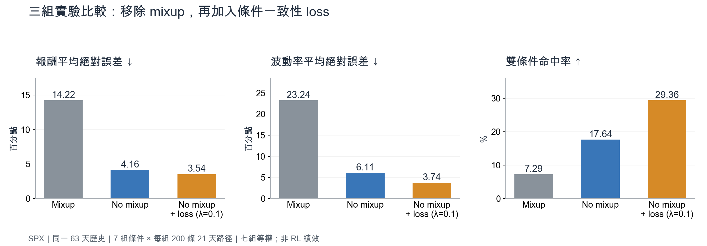
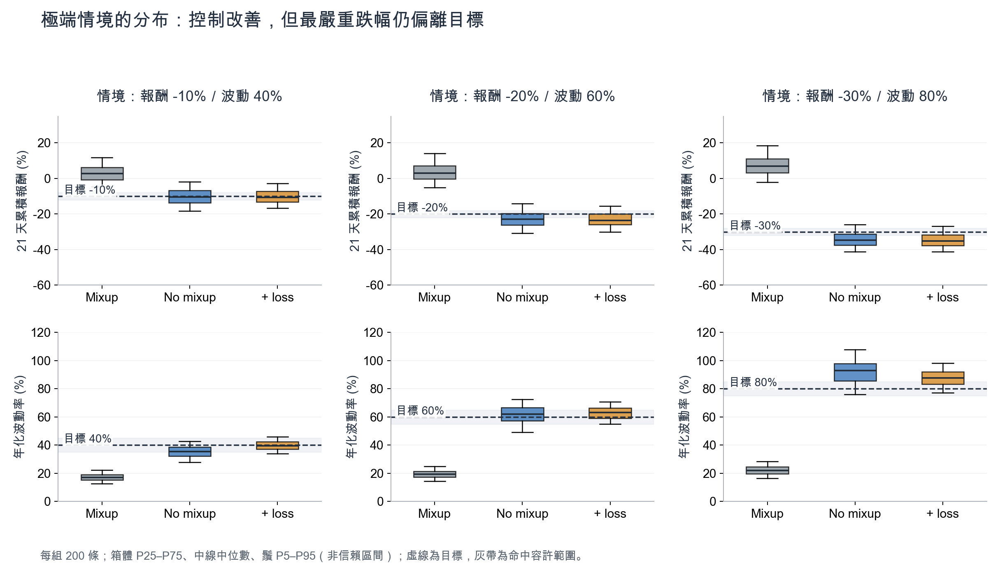
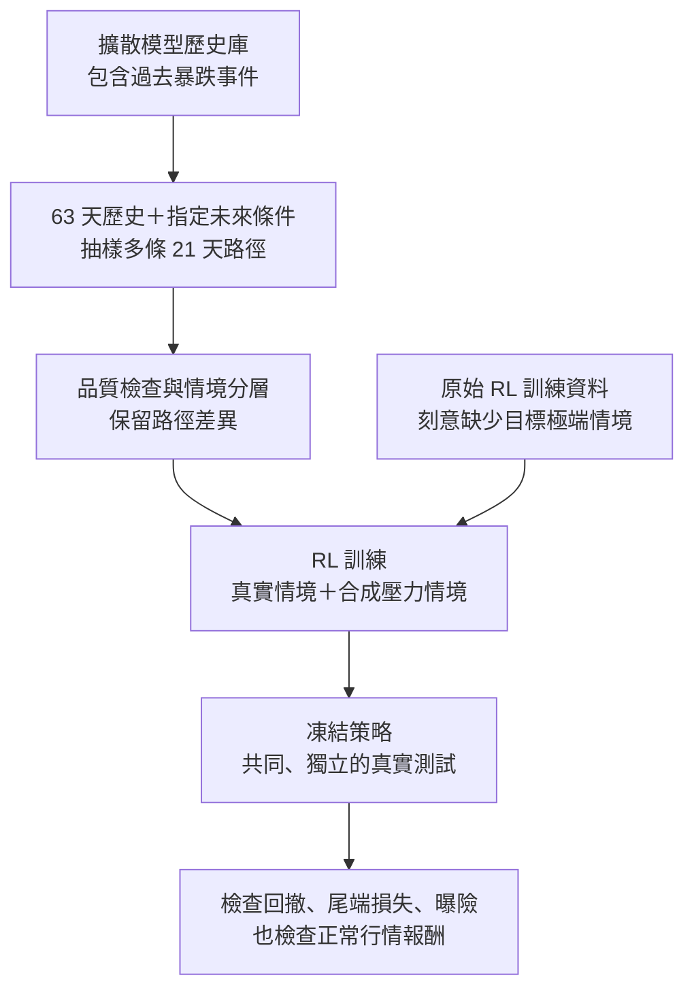

> **重點：No mixup + 條件一致性 loss（λ＝0.1）是目前較值得延續的版本。** 三組整體雙條件命中率依序為 **7.29% → 17.64% → 29.36%**；控制能力改善，但極端情境仍不精準。這是生成器實驗，**尚未證明 FinRL 能因此降低回撤**。

2026-09-29｜SPX 單一標的｜比較既有實驗，未新增訓練｜CFG 暫不實驗。

## 1. 這次要解決什麼問題？

希望指定「未來 21 天跌多少、波動多大」，生成多條不同路徑，補充 **RL 訓練資料缺少的市場情境**。第一步先確認生成器是否聽得懂條件；第二步才驗證策略能否從這些情境學會控制風險。

**兩份訓練資料要分清楚：**擴散模型的歷史資料可以包含暴跌；原始 RL 訓練資料則刻意不包含該情境。合成資料的作用是把生成器已學過的情境提供給 RL，並產生新的路徑樣本。這不等於可靠生成「連擴散模型都從未看過」的市場狀態。

本報告的條件描述 **未來 21 天目標**。先前的[長期市場背景實驗設計](https://app.notion.com/p/3dbce2558eff81daa49cdad7641bd78e)描述的是過去長歷史；兩者時間語意不同，本次結果不沿用該頁的設定。

## 2. 三組方法差在哪裡？

三組皆接收 63 天歷史、指定報酬與波動率；AR 先預訓後凍結，生成 21 天 SPX 路徑。

| 方法 | 訓練時的歷史條件分支 | 額外條件 loss | 目的 |
| --- | --- | --- | --- |
| A：Mixup | 歷史映射 F(H) 與真實未來逐元素隨機混合 | 無 | 本專案對照組 |
| B：No mixup | 只使用 F(H) | 無 | 讓此條件分支在訓練、生成時一致 |
| C：No mixup + loss | 只使用 F(H) | λ＝0.1 | 明確懲罰輸出統計量偏離指定條件 |

**Mixup 是什麼？** F(H) 把歷史轉成與未來等長的表示。Mixup 訓練時讓該表示混入部分真實未來，推論時只能使用 F(H)。這是 TimeDiff 原論文的訓練機制之一；A 是加入本專案金融條件與固定 AR 的版本，並非原論文完整基準重現。[TimeDiff 論文](https://proceedings.mlr.press/v202/shen23d.html)

**移除 mixup 仍有正常的監督學習。** 真實未來仍用來建立帶噪目標與訓練標籤，只是不再混入歷史條件分支。觀察到的改善與減少訓練／生成差異相符，但單次實驗尚不足以證明唯一原因。

**一致性 loss 做什麼？** 從單次去噪得到的乾淨路徑估計，計算報酬與波動率；每條路徑先與自己的目標比較，再對 batch 平均。

$$
L_{total}=L_{diffusion}+0.1L_R+0.1L_{\sigma}
$$

兩項條件誤差皆先用訓練資料的標準差標準化，再取平方。這是訓練懲罰，不是生成後把路徑強行調成目標；它也不是對完整多步取樣過程直接計算 loss。

### 條件與指標的定義

| 名稱 | 定義與讀法 |
| --- | --- |
| 21 天累積報酬 R | 末日收盤／起點收盤 − 1；等於 exp(21 天日對數報酬總和) − 1。−10% 表示 21 天合計下跌 10%，不是每日跌 10%。 |
| 年化波動率 σ | 21 個日對數報酬的樣本標準差（ddof＝1）× √252；40% 是年化尺度，不是 21 天報酬 40%。 |
| 平均絕對誤差 MAE | 每條路徑的統計量與指定值之絕對差，再平均。以「百分點」呈現；越低越好。 |
| 雙條件命中率 | 同一條路徑同時滿足報酬誤差 ≤ 2 百分點、年化波動率誤差 ≤ 5 百分點的比例；越高越好。 |

例如目標（−10%, 40%），報酬在 −12%～−8% 且波動率在 35%～45% 才算命中。平均值接近目標，並不代表每條路徑都命中。

## 3. 結果：改善主要出現在哪裡？

| 七組等權平均 | Mixup | No mixup | No mixup + loss |
| --- | --- | --- | --- |
| 報酬 MAE（百分點）↓ | 14.22 | 4.16 | **3.54** |
| 波動率 MAE（百分點）↓ | 23.24 | 6.11 | **3.74** |
| 雙條件命中率 ↑ | 7.29% | 17.64% | **29.36%** |

**先移除 mixup，改善幅度最大；再加 loss，命中率增加 11.71 百分點。** 七種情境的命中率皆比 No mixup 提高，但整體仍有約七成路徑未同時落入兩個容許範圍，不能視為精準控制已完成。

| 指定（21 天報酬／年化波動率） | Mixup 命中率 | No mixup 命中率 | + loss 命中率 |
| --- | --- | --- | --- |
| −5%／15% | 25.5% | 42.5% | **53.5%** |
| +5%／15% | 25.5% | 28.5% | **49.5%** |
| −5%／35% | 0.0% | 14.5% | **32.0%** |
| +5%／35% | 0.0% | 5.5% | **24.5%** |
| −10%／40% | 0.0% | 18.0% | **26.0%** |
| −20%／60% | 0.0% | 10.5% | **12.5%** |
| −30%／80% | 0.0% | 4.0% | **7.5%** |

### 極端情境：能生成下跌了，但最嚴重情境仍偏差較大

| 目標報酬／波動率 | Mixup 生成均值 | No mixup 生成均值 | + loss 生成均值 |
| --- | --- | --- | --- |
| −10%／40% | +2.92%／17.21% | −10.26%／35.37% | **−10.28%／39.68%** |
| −20%／60% | +3.59%／19.40% | −22.78%／61.68% | **−23.15%／62.88%** |
| −30%／80% | +7.33%／22.22% | −34.25%／91.95% | **−34.72%／87.71%** |

Mixup 在三組暴跌目標下，平均報酬仍為正；No mixup 後方向與幅度明顯改善。加入 loss 後，三組極端情境平均命中率由 **10.83% 提高至 15.33%**，但 −30% 情境的報酬 MAE 由 5.40 增至 5.45 百分點，並非每項指標都改善。

另一個品質訊號是價格合法性：生成後目前以 `rhigh = max(rhigh_raw, 0)`、`rlow = min(rlow_raw, 0)` 保證 High ≥ Close ≥ Low。七組平均的 High 修正比例為 **22.49% → 8.57% → 12.77%**，Low 為 **13.02% → 13.24% → 11.62%**（分母是生成日資料筆數）。加入 loss 後 High 修正變多，顯示「報酬與波動更準」不等於所有市場結構都更真實。修正沒有改動收盤報酬，因此不會直接改善上述命中率。

## 4. 如何用來降低 FinRL 面對極端事件的衝擊？

**以下是下一階段設計，尚未執行。** 目標是讓策略在多種情境中練習調整曝險，並以未見過的真實行情驗證；生成器只是提供訓練環境的一環。

### 先用「真實歷史＋單段未來」解決 50 天 state

每個 episode 從一段真實 63 天歷史開始；FinRL 使用其中最後 50 天作為初始觀察，再逐日揭露生成的 21 天。走完後重設到另一個起點／情境，不需要把多段生成資料硬接成長序列，也不必連續指定相同暴跌。

價格由起點收盤與生成日報酬逐日重建；技術指標只使用當時已知的真實＋已揭露合成資料。仍須檢查首個合成日的變化是否合理，價格連續不代表報酬、波動的銜接自然。若未來要研究跨月恢復與持續持倉，再另外處理長 episode。

### 讓策略有機會學會減曝險，而不是只學會怕市場

- **先做 SPX 風險資產＋現金的研究環境。** 允許策略降低風險資產權重，才有減曝險的動作空間；目前單一 SPX 生成器還不能代表多股票間的相關風險。未來多資產版本需聯合生成，不能各股獨立抽樣後就假設相關結構正確。
- **真實／合成混合訓練。** 在正常、下跌、高波動與恢復情境間抽樣；壓力情境比例由驗證集決定。增加暴跌訓練頻率是刻意強化練習，不代表真實暴跌機率。保留多條完整路徑，不先平均成一條平滑路徑。
- **未來標籤只給生成器。** 人工指定的未來報酬、波動率、事件時點與真實／合成標記，都不給 RL 當下的 state；策略只能依已觀察資訊決策。隨機化事件位置，避免學會「episode 一開始就一定跌」。
- **固定成本與 reward 再比較。** 先保持各組 RL 的 reward、交易成本、架構與互動步數相同，辨識資料增強本身的效果。若之後加入回撤或尾端風險懲罰，另做對照，避免把 reward 改動效果誤算為生成器貢獻。FinRL 的環境層可承載逐日互動與交易摩擦。[FinRL 環境文件](https://finrl.readthedocs.io/en/latest/finrl_meta/Environment_layer.html)

**能期待的是風險管理改善，不能承諾預知突然暴跌。** 若崩跌前沒有可辨識訊號，策略無法憑空提前知道；可能學到的是保留風險緩衝、在風險訊號出現後減曝險，以及減少持續下跌造成的後續損失。

### 怎樣才算真的有效？

以相同訓練預算比較三組：**僅真實資料**、**真實＋重抽樣歷史壓力片段**、**真實＋合成壓力片段**。第二組可分辨改善是來自「多練習暴跌」，還是合成路徑額外提供了價值。

在共同真實測試集、不同歷史背景、數個訓練 seed 與獨立極端事件上，檢查最大回撤、最差事件損失、事件期間風險資產權重、成本後報酬與換手率；同時檢查正常行情是否因過度持有現金而明顯退步。未見合成情境只作輔助壓力測試，不取代真實測試。

切分時先保留完整測試事件及相鄰緩衝區，不能只隨機分配高度重疊窗口。測試事件不得流入生成器、AR、正規化、條件篩選或 RL 選模；原始 RL 訓練中排除的目標情境，也要包含 state 暖機歷史的檢查，避免名義上排除、實際仍看過。擴散模型可使用更早的其他暴跌事件，但不得使用保留測試事件。

## 5. 現在可以下的結論與下一步

**保留 No mixup + loss（λ＝0.1）作下一階段候選，CFG 暫停。** 先增加歷史起點與 seed、校準極端情境、檢查日報酬尾端／波動叢聚／路徑多樣性與 High／Low 合法性，再進行上述 FinRL 對照實驗。

本次只有一個歷史起點、一個 seed、單一 SPX 標的。七組情境等權是診斷設計，不能解讀為真實市場中的成功機率；同 seed 也不代表 mixup 與 no mixup 的訓練亂數消耗完全配對。報酬與波動率只是兩個摘要，無法涵蓋急跌、陰跌、V 型反彈等所有路徑形狀，更不能宣稱已涵蓋所有市場狀態。

實驗設定、可重現資料與限制

	**資料與設定。** yfinance 的 SPX（^GSPC），2000–2024 共 6,289 筆日價格；訓練目標至 2021 年底、驗證目標 2022–2023、2024 保留。訓練／驗證／測試可用窗口為 5,452／481／232。特徵與條件標準化只使用訓練資料。AR 預訓 500 步後凍結；diffusion 2,000 步、batch 32、v 預測、100 個噪音層級、DPM 20 步取樣。
	**這次比較的是情境控制。** 三組皆用截至 2023-12-29 的相同歷史、seed 2024、相同七組條件，每組各生成 200 條 21 天路徑，共 4,200 條。不是 2024 年預測或交易回測。每條路徑獨立計算統計量；本報告已由原始 paths.csv 重算，與保存指標在 1e-10 容許差內相符。
	**模型選擇。** 依同一規則，在驗證集前 4 個 batch（128 個重疊窗口）做完整取樣，按標準化條件 MSE 選 checkpoint；三組分別選 step 100／900／2,000，分數 1.049102／0.485747／0.332294。不是固定相同步數的比較。λ＝0.1 在最後一步最佳，尚不能判定已收斂或 λ 最佳。
	**極端條件已有部分歷史支持。** 使用相同命中容許範圍，三組暴跌目標附近的訓練窗口數為 21／2／5；這些窗口互有重疊，不是 28 個獨立事件。因此本次不構成生成器對完全未見狀態的外推證據，也不構成未來實施「RL 缺少該情境」設計的完成證據。
	**來源目錄（TimeDiff/ 相對路徑）。** Mixup：`outputs/spx/crash_20260929/mixup_samples`；No mixup：`outputs/spx/crash_20260929/no_mixup_samples`；+ loss：`outputs/spx/condition_lambda_0p1/samples`。各目錄含 paths.csv、path_metrics.csv、summary.csv 與 sampling.json；train metadata 記錄選模結果。早期 Mixup metadata 未保存完整 training_config 與 code_commit，重現追溯程度較後兩組有限。
	**分析程式。** `scripts/build_spx_three_way_report.py` 只重算保存結果與繪圖，不訓練模型。報告、圖表、合併指標與雜湊 manifest 位於 `reports/spx_three_way_20260929/`；附於本頁的完整明細可下載核對。
	**方法依據。** [TimeDiff 原論文](https://proceedings.mlr.press/v202/shen23d.html)說明 future mixup 與 AR conditioning；[FinRL 環境文件](https://finrl.readthedocs.io/en/latest/finrl_meta/Environment_layer.html)說明市場環境與交易成本。本文數值來自本機實驗，FinRL 接入與驗證方案為本次提出的設計，兩份外部文件不直接證明本實驗的效益。

